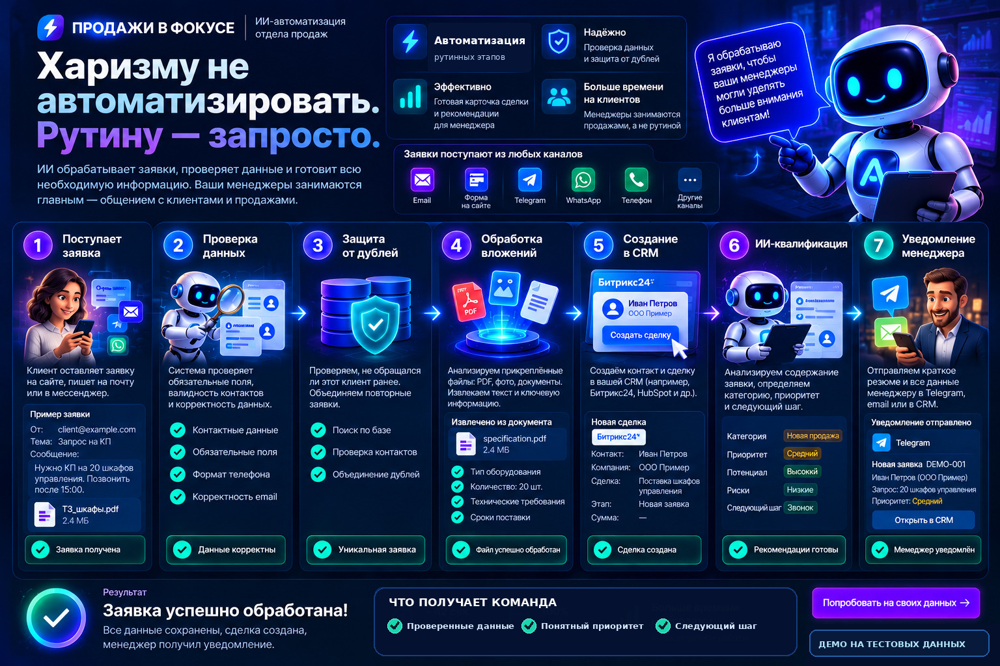

# Продажи в фокусе

### Харизму не автоматизировать. Рутину — запросто.

**ИИ-автоматизация входящих заявок.** Система подготавливает обращения к работе, чтобы менеджеры уделяли больше времени общению с клиентами.

## Продают люди. Рутину берёт на себя система.

Хороший менеджер должен общаться с клиентами, понимать их потребности и помогать принимать решение о покупке. Но вместо этого ему часто приходится проверять контакты, искать повторные заявки, разбирать документы и заполнять CRM.

**«Продажи в фокусе» освобождает менеджеров от лишней рутины.** Система проверяет обращения, выделяет важные детали и готовит понятную информацию о клиенте: что ему нужно, насколько срочен запрос и каким должен быть следующий шаг.

**Меньше времени на обработку заявок — больше внимания клиентам и продажам.**

## Что получает бизнес

| Было | Становится с автоматизацией |
|---|---|
| Обращения приходится разбирать вручную | Единый понятный процесс обработки |
| Контактные данные перепроверяются и копируются | Данные приводятся к общему формату |
| Повторные сообщения создают лишнюю работу | Система распознаёт повторные обращения |
| Чтобы разобраться в запросе, нужно перечитать сообщения | Краткое содержание и важные детали в одном месте |
| Не всегда понятно, что делать дальше | Категория, приоритет и следующий шаг |

## Как выглядит обработка заявки

**Клиент пишет:** «Нужно коммерческое предложение на 20 шкафов управления. Просьба позвонить после 15:00».

В демонстрационном сценарии система формирует:

| Информация | Результат |
|---|---|
| **Потребность** | Коммерческое предложение на 20 шкафов управления |
| **Категория** | Новая продажа |
| **Приоритет** | Обычный |
| **Важная деталь** | Связаться после 15:00 |
| **Следующий шаг** | Уточнить техническое задание и сроки поставки |

Менеджер начинает разговор, уже понимая потребность клиента. **Время тратится на диалог, а не на перенос информации.**

*Все имена, контакты и компании на иллюстрациях вымышлены.*

## Весь процесс — на одной схеме

1. **Получение:** заявка поступает в систему.
2. **Проверка:** контакты и обязательные данные приводятся к единому формату.
3. **Контроль повторов:** система определяет повторно пришедшее обращение.
4. **Вложения:** извлекаются доступные сведения; сомнительные случаи помечаются для ручной проверки.
5. **CRM:** подготавливается контакт и карточка сделки.
6. **ИИ-анализ:** определяется категория, приоритет и рекомендуемое действие.
7. **Менеджер:** формируется информация, с которой удобно начать разговор.

На иллюстрации источники заявок (почта, форма, Telegram, WhatsApp, телефон) показывают **возможные варианты подключения**, а не все уже подключённые каналы.

[Подробнее о семи этапах](docs/HOW_IT_WORKS.md)

## Для кого это решение

**B2B-компании** с запросами на коммерческие предложения и технические спецификации; **сервисные компании** с регулярными обращениями; **отделы продаж**, которым нужен единый порядок подготовки заявок.

Процесс можно адаптировать под правила, воронку и источники обращений конкретной компании.

## Основа решения

Создан **TEST-прототип** автоматической обработки заявок на n8n: получение входных данных, проверка, тестовый контроль повторов, анализ доступных сведений о вложениях, классификация и формирование результата для менеджера.

**Статус интеграций:** реальное создание сделки в Bitrix24, доставка уведомлений и обработка исходных файлов требуют отдельного подключения и проверки. Изображения показывают демонстрационный пользовательский сценарий, а не результаты коммерческого внедрения. Подтверждённых показателей роста продаж или экономии времени пока нет.

## Подробнее

- [Бизнес-задача и ценность](docs/BUSINESS_CASE.md)
- [Как обрабатывается заявка](docs/HOW_IT_WORKS.md)
- [Технологическая основа и статус интеграций](docs/TECHNICAL_SCOPE.md)

---

*Портфолио-кейс «Продажи в фокусе». В репозитории нет исполняемых workflow, закрытых настроек, API-ключей и реальных клиентских данных.*